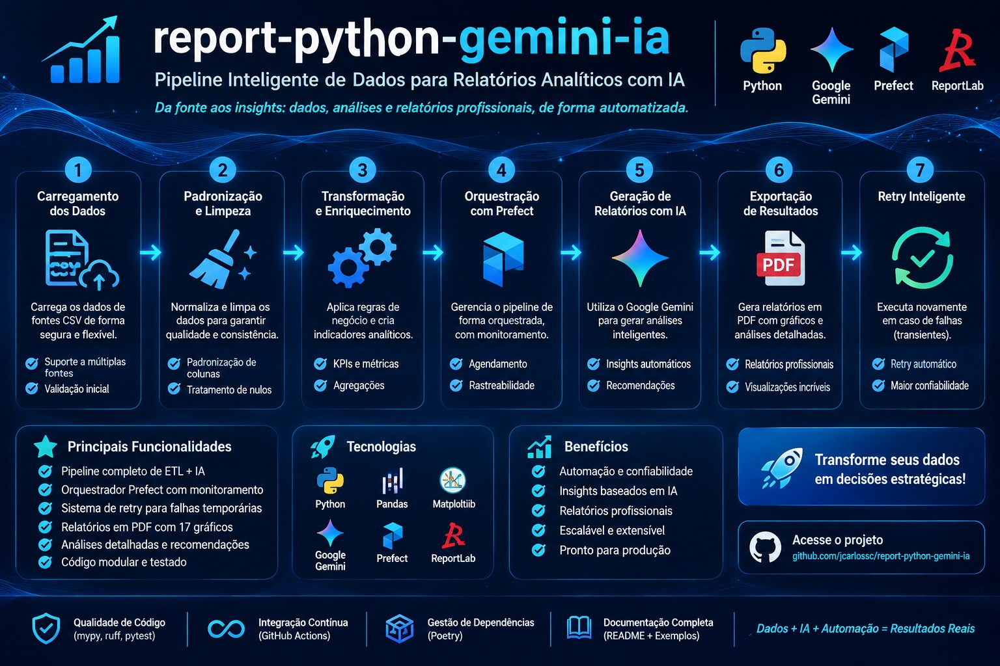
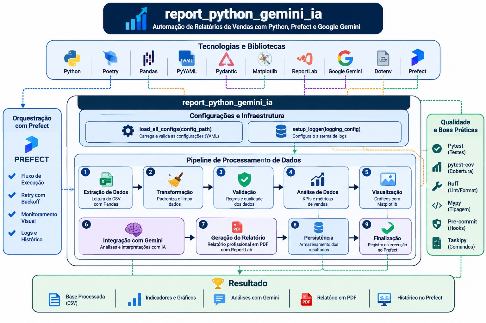
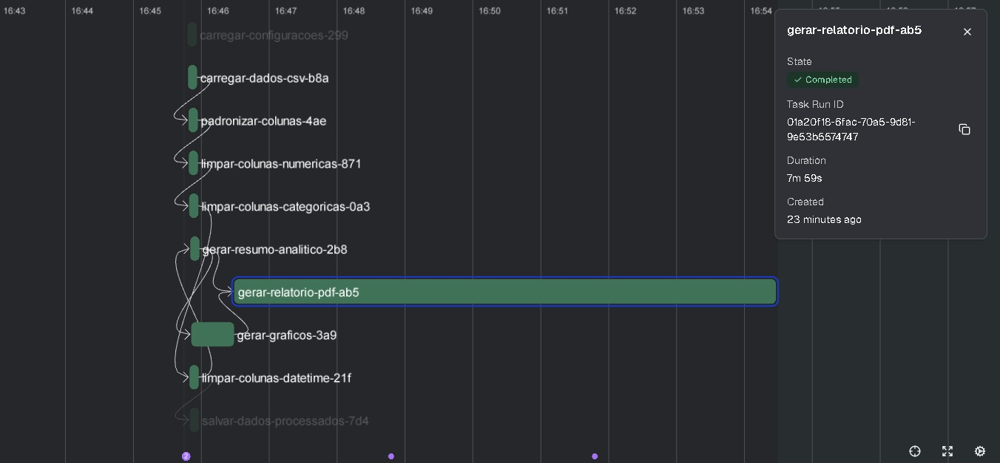
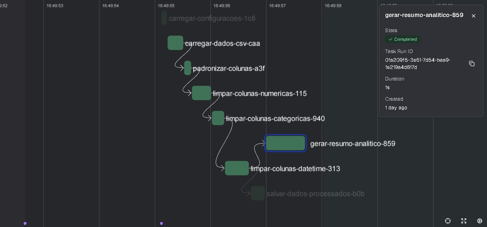
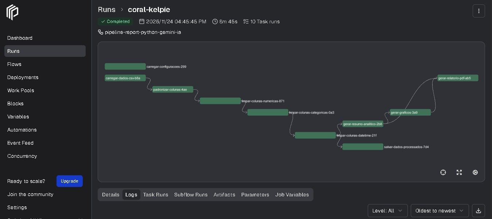
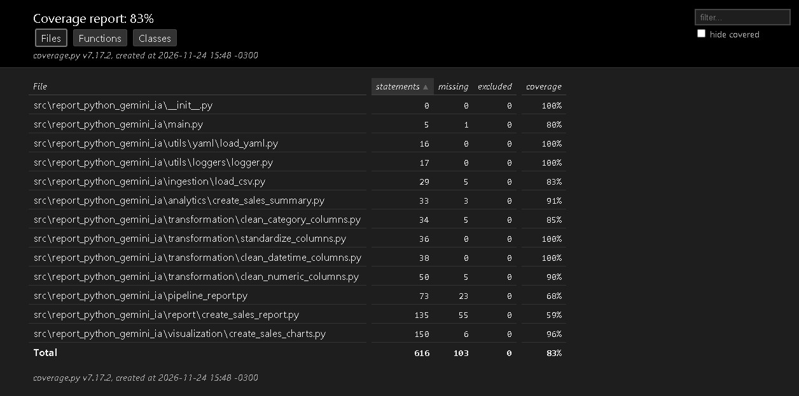
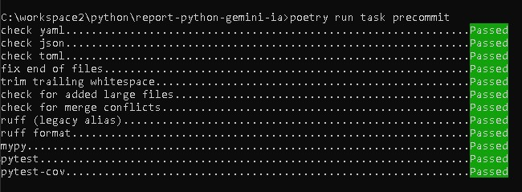
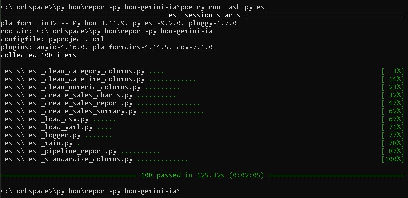

<table>
  <tr>
    <td> </td>
    <td> </td>
    <td> </td>
    <td> </td>
    <td> </td>
    <td> </td>
    <td> </td>
  </tr>
</table>

<a href="https://github.com/jcarlossc/report-python-gemini-ia/blob/main/images/DataQuantum_Relatorio_Vendas-compactado.pdf" download>Baixar RELATÓRIO DE VENDAS</a>
<p>Observação: o relatório acima está comprimido devidos as diretrizes de tamanho de arquivos do Github. O relatório gerado pelo sistema é muito superior em qualidade.</p>

### Automação de processamento, análise e geração de relatórios de vendas com Python, Pandas, Prefect e Google Gemini AI.

## Sobre o projeto

O Report Python Gemini IA é um projeto de engenharia e análise de dados desenvolvido para automatizar um fluxo completo de processamento de dados comerciais, desde a leitura de arquivos CSV até a geração de relatórios analíticos em PDF.

A solução combina técnicas de ETL (Extract, Transform, Load), análise exploratória, visualização de dados, validação de informações e inteligência artificial generativa.

O projeto utiliza o Prefect para orquestrar o pipeline, acompanhar sua execução, registrar estados e gerenciar novas tentativas de processamento em situações de falha.

O Google Gemini é integrado para ampliar a capacidade de interpretação dos resultados analíticos.

## Objetivos

* Automatizar o processamento de dados comerciais.
* Padronizar e higienizar bases de dados.
* Garantir qualidade e consistência das informações.
* Calcular indicadores-chave de desempenho (KPIs).
* Produzir gráficos e análises gerenciais.
* Utilizar inteligência artificial para interpretação dos resultados.
* Gerar relatórios profissionais em PDF.
* Orquestrar e monitorar a execução com Prefect.
* Implementar testes automatizados e validação estática de código.

## Arquitetura do projeto

A aplicação segue uma arquitetura modular, organizada por responsabilidades, utilizando o padrão src layout.

```
report-python-gemini-ia/
│
├── .github/
│   └── workflows/
│        └── release-please.yaml
├── data/
│   ├── data_raw/
│   │   └── global_sales.csv
│   └── data_processed/
│       └── global_sales_processed.csv
├── config/
│   ├── column_list.yaml
│   ├── logging.yaml
│   └── paths.yaml
├── htmlcov/
├── images/
├── logs/
│   └── app.log
├── reports/
│   ├── charts/
│   └── ...
├── src/
│   └── report_python_gemini_ia/
│       │
│       ├── __init__.py
│       ├── analytics/
│       │   └── create_sales_summary.py
│       ├── ingestion/
│       │   └── load_csv.py
│       ├── report/
│       │   └── create_sales_report.py
│       ├── transformation/
│       │   ├── standardize_columns.py
│       │   ├── clean_numeric_columns.py
│       │   ├── clean_datetime_columns.py
│       │   └── clean_category_columns.py
│       ├── utils/
│       │   ├── load_yaml/
│       │   │   └── .py
│       │   └── loggers/
│       │       └── logger.py
│       ├── visualization/
│       │   └── create_sales_charts.py
│       ├── main.py
│       └── pipeline_report.py
├── tests/
│   ├── _init_.py
│   ├── test_clean_category_columns.py
│   ├── test_clean_datetime_columns.py
│   ├── test_clean_numeric_columns.py
│   ├── test_create_sales_charts.py
│   ├── test_create_sales_report.py
│   ├── test_create_sales_summary.py
│   ├── test_load_csv.py
│   ├── test_load_yaml.py
│   ├── test_logger.py
│   ├── test_main.py
│   ├── test_pipeline_report.py
│   └── test_standardize_columns
├── coverage
├── .env
├── .env.example
├── .gitignore
├── .pre-commit-config.yaml
├── .release-please-manifest.json
├── CHANGELOG.md
├── LICENSE
├── poetry.lock
├── pyproject.toml
├── release-please-config.json
└── README.md

```

## Fluxo de processamento de dados

O processamento é organizado em etapas independentes, coordenadas pelo pipeline principal.

### Visão geral

```
flowchart TD
    A["main.py"] --> B["pipeline_report.py"]
    B --> C["Carregamento das configurações YAML"]
    C --> D["Validação das configurações"]
    D --> E["Extração dos dados CSV"]
    E --> F["Padronização das colunas"]
    F --> G["Limpeza dos dados"]
    G --> H["Validação dos dados processados"]
    H --> I["Persistência CSV"]
    I --> J["Análise de dados e KPIs"]
    J --> K["Visualização com Matplotlib"]
    K --> L["Interpretação com Google Gemini"]
    L --> M["Geração do relatório PDF"]
    M --> N["Relatório final"]
```
### 1. Inicialização da aplicação

O módulo main.py funciona como ponto de entrada da aplicação.

Sua responsabilidade é inicializar o processamento e delegar a execução ao pipeline principal.

### 2. Carregamento das configurações

As configurações da aplicação são centralizadas em arquivos YAML.

O carregamento é realizado por meio da função load_all_configs(config_path).

Essa abordagem permite separar parâmetros de execução e regras de processamento do código Python.

São utilizados arquivos de configuração para orientar aspectos como:

* Caminhos dos arquivos de entrada e saída.
* Definição e padronização de colunas.
* Tipos de dados esperados.
* Regras de limpeza e transformação.
* Parâmetros de análise e geração de relatórios.

O Pydantic pode ser utilizado para validar estruturas e parâmetros configurados.

### 3. Extração dos dados (Extract)

A extração utiliza arquivos CSV como fonte de dados.

O Pandas realiza a leitura e disponibiliza os registros para as etapas seguintes.

Base utilizada: Global Sales Dataset.

Entre as informações disponíveis estão:

* Identificação dos pedidos.
* Datas das vendas.
* Clientes e segmentos.
* Países e regiões.
* Categorias e produtos.
* Quantidades e preços.
* Descontos.
* Vendas e lucros.
* Custos de envio.
* Formas de pagamento.

### 4. Transformação dos dados (Transform)

A transformação prepara os dados para análises confiáveis.

As principais operações incluem:

Padronização de colunas:

* Normalização dos nomes das colunas.
* Remoção de acentos quando necessário.
* Padronização de caracteres e nomenclaturas.

Limpeza de dados numéricos:

* Conversão de valores para tipos numéricos.
* Tratamento de valores inválidos.
* Tratamento de campos vazios e valores nulos.
* Verificação de inconsistências.

Limpeza de dados categóricos:

* Padronização de categorias.
* Tratamento de espaços em branco.
* Normalização de valores textuais.
* Tratamento de valores ausentes.

Validação:

* Verificação das colunas obrigatórias.
* Conferência dos tipos de dados.
* Verificação de valores nulos.
* Validação das regras definidas nos arquivos YAML.

### 5. Carregamento dos dados (Load)

Após a transformação, os dados processados são armazenados em um novo arquivo CSV.

A separação entre dados originais e processados preserva a fonte de entrada e facilita a rastreabilidade.

### 6. Análise de dados e indicadores

Com a base preparada, são realizadas análises comerciais e financeiras.

Os indicadores incluem:

* Faturamento total.
* Lucro total.
* Quantidade de pedidos.
* Ticket médio.
* Quantidade de produtos vendidos.
* Desempenho por categoria.
* Desempenho por produto.
* Análise de clientes e segmentos.
* Desempenho geográfico.
* Evolução temporal das vendas.
* Análise de formas de pagamento.
* Indicadores de rentabilidade.

Os resultados são organizados em estruturas de dados para alimentar as visualizações e os relatórios.

### 7. Visualização dos dados

O Matplotlib é utilizado para construir gráficos que facilitam a interpretação dos resultados.

As visualizações contemplam diferentes perspectivas:

* Indicadores gerais.
* Desempenho de produtos.
* Categorias comerciais.
* Perfil de clientes.
* Distribuição geográfica.
* Evolução temporal.
* Formas de pagamento.
* Análises financeiras.

Os gráficos são utilizados como elementos visuais do relatório final.

### 8. Integração com Google Gemini AI

A biblioteca google-genai permite integrar o Google Gemini ao processo analítico.

A inteligência artificial pode ser utilizada para interpretar os indicadores calculados e produzir comentários em linguagem natural.

Entre as possibilidades estão:

* Interpretação dos KPIs.
* Identificação de tendências.
* Comentários sobre desempenho comercial.
* Destaques sobre resultados financeiros.
* Síntese gerencial dos indicadores.
* Apoio à elaboração das conclusões.

A análise quantitativa é realizada pelo Python. O Gemini atua como camada complementar de interpretação, não como substituto dos cálculos.

### 9. Geração do relatório PDF

O ReportLab é utilizado para produzir o documento final.

O relatório reúne informações quantitativas, gráficos e interpretações geradas durante o processamento.

A composição contempla:

* Identificação do relatório.
* Indicadores de desempenho.
* Análises comerciais.
* Gráficos.
* Comentários analíticos.
* Conclusões gerenciais.

O resultado é um documento estruturado para apresentação e acompanhamento dos resultados de vendas.

## Orquestração com Prefect

O Prefect é responsável pela orquestração e pelo gerenciamento da execução do pipeline.

Sua utilização permite acompanhar o processamento, identificar falhas, registrar estados e configurar políticas de repetição automática.

## Arquitetura de execução
```
flowchart TD
    A["main.py"] --> B["Prefect Flow"]
    B --> C["Pipeline de processamento"]
    C --> D["Tasks"]
    D --> E{"Execução concluída?"}
    E -->|Sim| F["Finalização"]
    E -->|Não| G{"Existem retries disponíveis?"}
    G -->|Sim| H["Aguardar backoff"]
    H --> D
    G -->|Não| I["Registrar falha"]
```

## Retry com backoff exponencial

Uma das funcionalidades importantes do Prefect é permitir novas tentativas de execução quando uma tarefa apresenta falha.

O projeto pode utilizar uma política de Retry com Exponential Backoff, especialmente útil para operações sujeitas a instabilidades externas, como chamadas à API do Google Gemini.

O intervalo entre as tentativas aumenta progressivamente.

Exemplo de configuração:
```
@task(
    name="gerar-relatorio-pdf",
    retries=5,
    retry_delay_seconds=[5, 10, 20, 40, 60],
)
...
```
Exemplo ilustrativo dos intervalos:

| Tentativa | Tempo de espera |
| --------- | --------------- |
| Primeira repetição | 5 segundos |
| Segunda repetição | 10 segundos |
| Terceira repetição | 20 segundos |
| Terceira repetição | 40 segundos |
| Terceira repetição | 60 segundos |

O jitter adiciona uma variação aos intervalos para evitar que múltiplas execuções tentem acessar um serviço simultaneamente.

A configuração deve ser aplicada às tarefas que realmente precisam de recuperação automática, principalmente operações sujeitas a falhas transitórias.

Importante: o retry não corrige erros permanentes, como configurações inválidas, arquivos inexistentes ou dados inconsistentes. Essas situações devem ser tratadas por validações específicas.

## Monitoramento visual

O Prefect disponibiliza uma interface gráfica para acompanhar as execuções.

Inicialização do servidor local:
```
poetry run prefect server start
```
Inicialização do servidor local com logs:
```

```

Interface:
```
http://127.0.0.1:4200
```
A interface permite acompanhar:

* Execuções dos flows.
* Estados das tarefas.
* Histórico de processamento.
* Falhas e exceções.
* Tentativas de repetição.
* Duração das execuções.
* Logs de processamento.

## Tecnologias utilizadas

### Linguagem e gerenciamento

| Tecnologia | Finalidade |
| ---------- | ---------- |
| Python | Linguagem principal |
| Poetry | Gerenciador de dependências e ambiente |
| Taskipy | Automação de comandos |
| python-dotenv | Gerenciamento de variáveis de ambiente |
| Pyyaml | Leitura e configuração YAML |
| Pydantic | Validação de dados e configuração |

### Engenharia e análise de dados

| Tecnologia | Finalidade |
| ---------- | ---------- |
| Pandas | Manipulação e transformação de dados |
| Matplotlib | Visualização de dados |
| ReportLab | Geração de relatório |
| Google GenIA | Integração com inteligência artificial |
| Prefect | Orquestração de pipelines |

### Qualidade e testes

| Tecnologia | Finalidade | Comando |
| ---------- | ---------- | ------- |
| Pytest | Testes automatizados | Poetry run task pytest |
| pytest-cov | Cobertura de testes | Poetry run task covreport |
| pytest-cov | Cobertura de testes - console | Poetry run task covconsole |
| Ruff | Lint | poetry run task lint |
| Ruff | Formatação | poetry run task format |
| Mypy | Verificação estática de tipos | poetry run task mypy |
| Pre-commit | Execução automática de verificações antes dos commits | poetry run task precommit |

## Requisitos

* Python 3.11 ou superior, respeitando a faixa de compatibilidade configurada no projeto.
* Poetry.
* Git.
* Chave de API do Google Gemini.

### Instalação

1. Clonar o repositório:
```
git clone https://github.com/jcarlossc/report-python-gemini-ia.git

cd report-python-gemini-ia
```
### 2. Instalar as dependências
```
poetry install
```
3. Configurar as variáveis de ambiente

Crie um arquivo .env na raiz do projeto.

Exemplo:
```
GEMINI_API_KEY=sua_chave_de_api
```
O arquivo .env não deve ser versionado

4. Verificar a instalação
```
poetry run python --version

poetry run prefect version

poetry show
```

## Execução

### Executar a aplicação
```
poetry run task app
```

## Boas práticas adotadas

* Organização modular por responsabilidade.
* Separação entre extração, transformação e análise.
* Configurações externas em YAML.
* Tipagem estática com Mypy.
* Padronização com Ruff.
* Testes automatizados com Pytest.
* Controle de cobertura com pytest-cov.
* Validação de dados e configurações.
* Gerenciamento de dependências com Poetry.
* Orquestração com Prefect.
* Recuperação de falhas transitórias com Retry e backoff exponencial.
* Separação de credenciais por variáveis de ambiente.
* Versionamento com Git.

## Testes

### Testes automatizados

O projeto utiliza Pytest para verificar o comportamento das funções e dos módulos.

Executar todos os testes:
```
poetry run task pytest
```
Executar testes com cobertura:
```
poetry run task covreport
```
O relatório poderá ser consultado em: ```htmlcov/index.html````

Executar testes com cobertura e mostra no console:
```
poetry run task covconsole
```
### Qualidade de código

O projeto utiliza ferramentas de análise estática e padronização para manter a consistência e a confiabilidade do código.

Ruff

Verificar problemas de lint:
```
poetry run task lint
```
Corrigir automaticamente os problemas compatíveis:
```
poetry run task fix
```
Mypy

Verificar tipagem estática:
```
poetry run task mypy
```
Pre-commit

Executar os hooks configurados:
```
poetry run task precommit
```


## Resultados esperados

Ao concluir o processamento, a aplicação disponibiliza:

1. Base de dados original preservada.
2. Base de dados processada e padronizada.
3. Indicadores comerciais e financeiros.
4. Gráficos analíticos.
5. Interpretações complementares com Google Gemini.
6. Relatório gerencial em PDF.
7. Histórico e monitoramento das execuções pelo Prefect.Boas práticas adotadas
* Organização modular por responsabilidade.
* Separação entre extração, transformação e análise.
* Configurações externas em YAML.
* Tipagem estática com Mypy.
* Padronização com Ruff.
* Testes automatizados com Pytest.
* Controle de cobertura com pytest-cov.
* Validação de dados e configurações.
* Gerenciamento de dependências com Poetry.
* Orquestração com Prefect.
* Recuperação de falhas transitórias com Retry e backoff exponencial.
* Separação de credenciais por variáveis de ambiente.
* Versionamento com Git.
